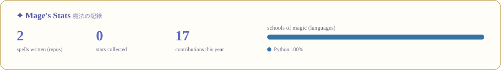
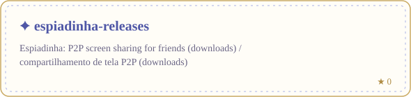
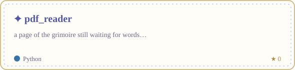

<div align="center">

<!-- BANNER:START -->

<!-- BANNER:END -->


</div>


## 📖 Journey Log <sub>〜 旅の記録</sub>

> *Day 1 of the journey: I opened a new page of my grimoire here on GitHub.*
> *Along the way I'll be collecting projects, ideas and little spells, even the useless ones.*
> ***Especially* the useless ones.** ✿

<div align="center">

| | ✦ Mage's Record <sub>魔法使いの記録</sub> | |
|:-:|:--|:--|
| 🔮 | **Class** | Mage (apprentice rank on GitHub) |
| ✿ | **Favorite spell** | making a field of flowers bloom |
| 📺 | **Watching** | *Frieren: Beyond Journey's End* |
| 😴 | **Weakness** | waking up early |
| 🧭 | **Status** | on a journey, one repository at a time |

</div>


<!-- GARDEN:START -->



<!-- GARDEN:END -->

## ✦ Collected Spells <sub>〜 集めた魔法</sub>

<div align="center">


<!-- 💡 Quando quiser mostrar linguagens/ferramentas, é só copiar um badge acima
     e trocar o nome e o logo (lista de logos: https://simpleicons.org). Ex.:

-->

</div>

<!-- 💡 A seção abaixo é preenchida sozinha pelo robô diário (.github/workflows/daily-magic.yml).
     Ela só aparece quando você tiver repositórios públicos. -->
<!-- GRIMOIRE:START -->


## 📚 Grimoire Pages <sub>〜 魔導書のページ</sub>

<div align="center">



<a href="https://github.com/ggekkos/espiadinha-releases"></a>
<a href="https://github.com/ggekkos/pdf_reader"></a>

</div>

<!-- GRIMOIRE:END -->


## 🌙 Spell of the Day <sub>〜 今日の魔法</sub>

<!-- SPELL:START -->
```diff
  ✦ SPELL OF THE DAY · Nov 19, 2026 ✦
  花畑を出す魔法 · Spell to Make a Field of Flowers

+ effect:              fills any dull place with flowers
+ use in battle:       none whatsoever
+ use for happiness:   immeasurable
- side effects:        none (unlike opening chests)

  cast before starting a new repository ✿
```
<sub>✦ a new useless spell is found every day · 毎日ひとつ、新しい魔法</sub>
<!-- SPELL:END -->

<div align="center">


</div>
