<div align="center">




</div>


## 📜 Apothecary's Diary

> *Day 1: I opened my very own apothecary here on GitHub.*
> *Between one herb and the next, I'll be storing projects, ideas and little experiments.*
> *I haven't figured out if any of them are poisonous yet... but curiosity always wins.* 🌿

<div align="center">

| | 🏮 Apothecary's Record | |
|:-:|:--|:--|
| 🌸 | **Mood** | curious, slightly suspicious |
| 🍵 | **Drink** | jasmine tea (poison-free, I think) |
| 📚 | **Reading** | *The Apothecary Diaries* |
| 🧪 | **Hobby** | solving palace mysteries |
| 🎐 | **Status** | exploring GitHub, one step at a time |

</div>


## 🌿 Herb Drawer

<div align="center">


<!-- 💡 Quando quiser mostrar linguagens/ferramentas, é só copiar um badge acima
     e trocar o nome e o logo (lista de logos: https://simpleicons.org). Ex.:

-->

</div>


## 🧾 Prescription of the Day

```diff
  ✿ APOTHECARY'S PRESCRIPTION ✿

+ 1 cup of warm tea
+ 2 handfuls of curiosity
+ 1 pinch of courage to try new things
- 0 poisons (this time, I promise)

  directions: take before opening a new repository 🍵
```

<div align="center">


</div>
